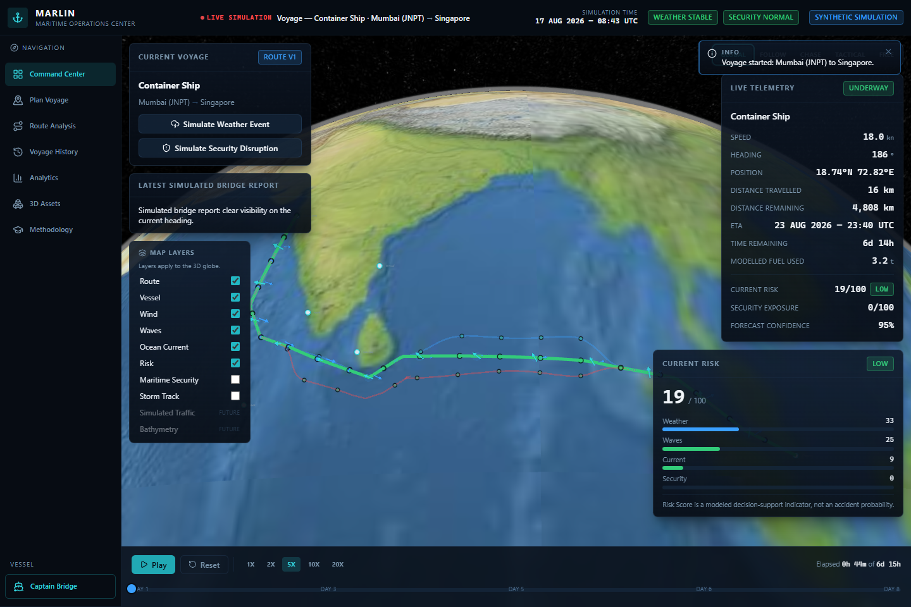
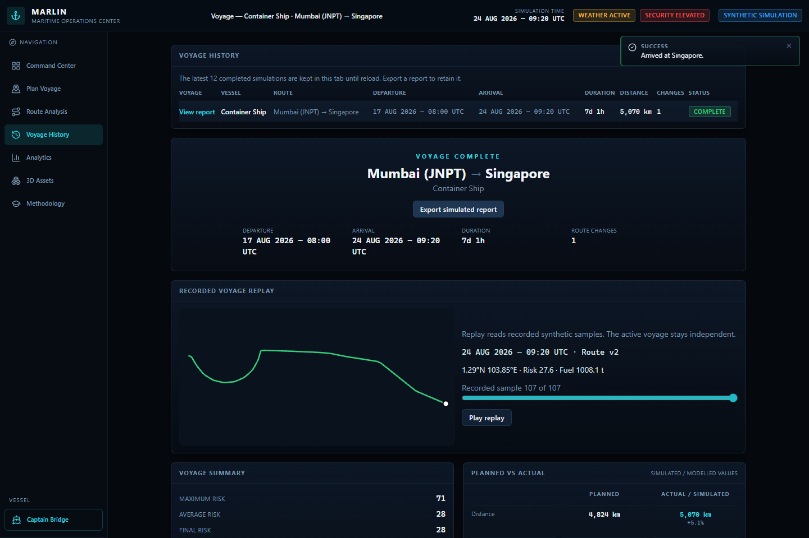

# MARLIN

MARLIN (Maritime Adaptive Risk-aware Logistics & Intelligent Navigation) is a browser-based voyage simulator by **Team Topaz**. It shows how a ship routing decision changes when time, fuel and modeled risk compete, then lets you compare the planned voyage with what happened in the simulation.

**Synthetic demonstration.** MARLIN uses fixed geographic fixtures and simulated conditions. It has no live AIS or weather forecasts and is not for navigation or operational decisions.



The [fixed demo](#try-a-voyage) covers planning, shared shore and bridge controls, a reroute decision, arrival, replay and JSON export. Try the [live MARLIN demo](https://siddharth-18-maru.github.io/MARLIN/). See [credits](CONTRIBUTORS.md) and [notices](NOTICE.md).

## Run locally

Use Node.js 22.23.4. Local release verification used npm 10.9.9 on Windows.

```powershell
npm ci --ignore-scripts
npm run dev
```

Open `http://127.0.0.1:5173/`. The build and the application have different network requirements. Package installation requires the npm registry or a populated cache. The built application loads imagery, workers, charts and generated vessel models from the same local site.

```powershell
npm test
npm run lint
npm run build
npm run preview
```

Vite preview binds to loopback for local verification. `dist/` contains the static build. Hash routes such as `/#/plan` work from the host root and keep session state during navigation. Reloading starts a new browser session.

## Try a voyage

1. Choose **Run Full Demo** to load the fixed Mumbai → Singapore plan with a container ship and a departure of 17 August 2026 at 08:00 UTC. Alternatively, choose a port pair, vessel, departure and routing preferences in **Plan Voyage**.
2. Generate three candidates. Compare time, distance, modeled fuel, modeled exposure and route explanations. Select a candidate to assign it.
3. Start the simulation in the **Command Center** or **Captain Bridge**. Both screens share one browser-local voyage. The clock continues as you move between them. Weather and security events can occur at deterministic checkpoints or be triggered from the Command Center.
4. Approve a lower-risk reroute or retain the current plan. If the candidate search finds no improvement, the assigned route stays in effect. Reaching the destination produces a report.
5. Open **Voyage History** to view planned versus simulated results, charts, version history, events and counterfactual estimates. Replay the recorded samples, or export the synthetic report as JSON. **Analytics** compares five vessel profiles using the same departure, corridor and weights.

The last 12 completed reports are held in memory in this tab. The Captain Bridge and Command Center share that tab's state. Communications and alerts stay in the simulation. The interface accepts no file uploads, credentials, live positions or external control commands.

## Routing and architecture

The planning and bridge views share one Zustand store. Client-side service functions run the corridor and simulation models, then feed the Cesium map, Three.js bridge and Recharts reports. Vite builds a static client; all required imagery, workers and hulls are served from the same origin. Voyage state stays in the current tab.

- A small hand-built Indian Ocean corridor graph connects 12 ports. Dijkstra selects a base corridor. The engine generates three candidate shapes and uses coarse land boxes to limit lateral offsets.
- The existing segment evaluator samples the deterministic environment at the projected time, then calculates speed, ETA, fuel and modeled risk. Recommendation ranking favors candidates within the prototype threshold plus 15 points of tolerance, then minimizes a weighted sum of modeled risk, fuel and elapsed time. Fuel and time are normalized against the candidate set. If all three exceed the model limit, the route cards disclose the exceedance. The fastest remaining candidate is labeled **Fastest Alternative**.
- Mid-voyage reevaluation starts at the vessel's current position and time. The local heuristic evaluates candidate detours in both directions around active hazards, screens changed segments against coarse exclusion boxes and offers a proposal only when modeled peak risk improves. The operator decides whether to apply it.
- React 19 and TypeScript provide the UI, Zustand owns session state, Cesium renders the operations map, React Three Fiber powers the Captain Bridge view, and Recharts displays time series. Vite builds the client, and Vitest checks the engine and stores. `src/services/` wraps local calculations with async interfaces that could support a future backend.
- Cesium's bundled Natural Earth II imagery gives geographic context. A schematic and accessible route metrics remain available without WebGL. The Captain Bridge loads its 3D scene when needed. Five generated GLB hulls are credited in **3D Assets**. The unverified imported ship models and Draco decoder copies were withheld. [CesiumJS license and notices](https://github.com/CesiumGS/cesium/blob/1.144/LICENSE.md), [Natural Earth terms](https://www.naturalearthdata.com/about/terms-of-use/).

## Verification

The 20 Vitest tests cover route fixtures and store transitions, including deterministic outcomes and position continuity when a reroute is accepted or rejected. The Windows release checks cover Chromium, Firefox and WebKit, including accepted and rejected reroutes, export and WebGL fallback on a local static server. See [browser QA](qa/README.md) for commands and scope. Automated accessibility checks cover the tested views; real-device and assistive-technology checks are separate.



## Limitations and release layout

This prototype uses synthetic conditions and representative vessel profiles. Modeled risk is a comparative score. The coarse graph and exclusion boxes can miss coastlines, restricted waterways or clearance constraints. The application does not supply live AIS, weather, satellite observations, bathymetry, an authenticated command service or certified navigation guidance. Illustrative confidence figures and counterfactuals are model outputs. Avoid entering operational or personal data.

MARLIN's original code is available under the [MIT License](LICENSE). Preserve [Team Topaz credit](CONTRIBUTORS.md) and the [third-party notices](NOTICE.md). The source release contains the reviewed application and assets, lockfiles, tests and setup docs.

The client has no API or database to host. [Static deployment instructions](docs/STATIC_HOSTING.md) cover a root build for Render Static Sites and a separate repository-subpath build for GitHub Pages. See the same document for release gates. Research extensions could validate route feasibility and modeled costs against licensed observations in a separate study.

